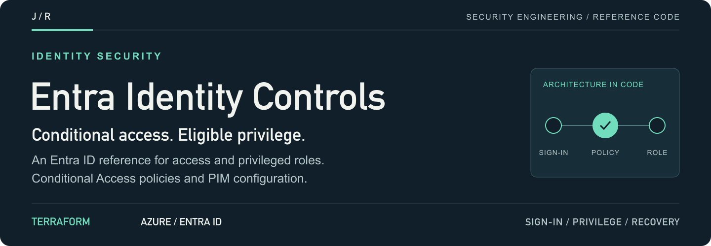
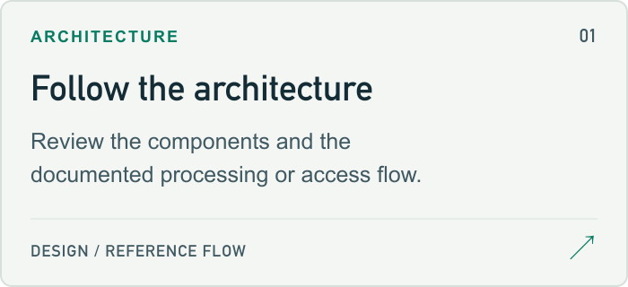
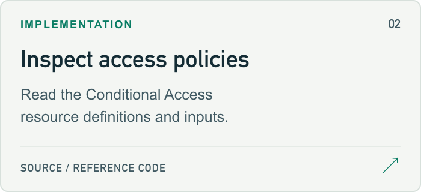
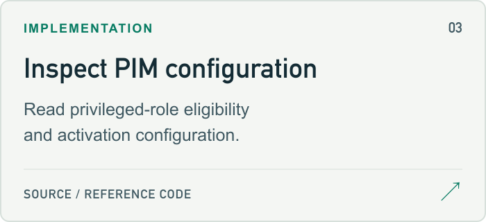
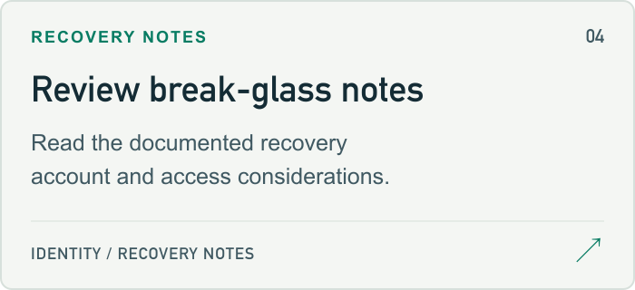

<a id="azure-entra-id-conditional-access--privileged-identity-management"></a>

<a href="#setup-guide">
<picture>
  <source media="(max-width: 600px)" srcset="docs/assets/readme/header-mobile.png">
  
</picture>
</a>

<p>
  <a href="#setup-guide"><strong>Start here ↗</strong></a> &nbsp; / &nbsp;
  <a href="terraform/main.tf">Source</a> &nbsp; / &nbsp;
  <a href="#project-guide">Project guide</a> &nbsp; / &nbsp;
  <a href="https://github.com/jmragsdale">Profile</a>
</p>

An Entra ID reference for Conditional Access and Privileged Identity Management, with Terraform source and recovery-account notes.

## Explore the project

Open a card for source, examples or supporting documentation.

<p>
<a href="entra-ca-pim-architecture.svg">
<picture>
  <source media="(prefers-color-scheme: dark)" srcset="docs/assets/readme/architecture-dark.png">
  
</picture>
</a>
<a href="terraform/main.tf">
<picture>
  <source media="(prefers-color-scheme: dark)" srcset="docs/assets/readme/source-dark.png">
  
</picture>
</a>
<a href="terraform/pim.tf">
<picture>
  <source media="(prefers-color-scheme: dark)" srcset="docs/assets/readme/privilege-dark.png">
  
</picture>
</a>
<a href="#recovery-guide">
<picture>
  <source media="(prefers-color-scheme: dark)" srcset="docs/assets/readme/recovery-dark.png">
  
</picture>
</a>
</p>

## Project guide

Zero-trust identity controls for Microsoft Entra ID: Conditional Access policies enforcing MFA, device compliance, and risk-based gating, plus Privileged Identity Management (PIM) for just-in-time admin elevation.

## 🎯 Overview

Reference Entra ID (Azure AD) hardening pattern that eliminates standing privilege. Admin roles are **eligible** rather than **active** — they must be activated through PIM with MFA + justification + time limit. All sign-ins flow through Conditional Access, which blocks legacy auth, requires compliant devices for sensitive apps, and quarantines risky sessions.

## 🏗️ Architecture

<details>
<summary>Architecture flow (text)</summary>

```
┌──────────────────────────────────────────────────────────────┐
│                      Microsoft Entra ID                      │
│                                                              │
│   ┌─────────────────┐                                        │
│   │ User sign-in    │                                        │
│   │ (any app)       │                                        │
│   └────────┬────────┘                                        │
│            ▼                                                 │
│   ┌─────────────────────────────────────────┐                │
│   │      Conditional Access Engine          │                │
│   │  • Block legacy auth (always)           │                │
│   │  • Require MFA for all users            │                │
│   │  • Require compliant device for admins  │                │
│   │  • Block sign-in from risky locations   │                │
│   │  • Force re-auth on high sign-in risk   │                │
│   └────────┬─────────────────────┬──────────┘                │
│       ALLOW                  CHALLENGE / BLOCK               │
│            ▼                                                 │
│   ┌─────────────────┐    ┌──────────────────────────────┐    │
│   │ Standard access │    │ PIM — Just-in-Time           │    │
│   │ to apps         │    │ Eligible → activate → MFA →  │    │
│   │                 │    │ justification → 1-8h max     │    │
│   └─────────────────┘    │ → audit log → auto-expire    │    │
│                          └──────────────────────────────┘    │
│                                                              │
│   ┌────────────────────────────────────────────────────┐     │
│   │ Sign-in & audit logs → Log Analytics → Sentinel    │     │
│   └────────────────────────────────────────────────────┘     │
└──────────────────────────────────────────────────────────────┘
```

</details>

## ✨ Features

- 🚫 **Block Legacy Auth** — POP, IMAP, SMTP basic auth completely blocked
- 🔐 **MFA Everywhere** — Required for all users on all cloud apps
- 💻 **Device Compliance Gating** — Admin portals require Intune-compliant device
- 🌍 **Named Locations** — Country/IP allow-lists; high-risk regions blocked
- ⚡ **Risk-Based Policies** — High sign-in risk → block; medium → MFA + password change
- ⏱️ **PIM Just-in-Time** — Zero standing admin privilege; activate per-task with approval
- 📜 **Activation Justification** — Every elevation requires reason + ticket reference
- 📊 **Sign-in Forensics** — All Entra logs streamed to Log Analytics + Sentinel

<a id="setup-guide"></a>

## 🚀 Quick Start

```bash
# Authenticate as a Global Administrator (or Conditional Access Admin + PIM Admin)
az login --tenant <your-tenant-id>

cd terraform
terraform init
terraform plan -var-file=terraform.tfvars
terraform apply
```

> **⚠️ Test in report-only mode first.** Every Conditional Access policy here is created with `state = "enabledForReportingButNotEnforced"` by default. Flip to `enabled` only after reviewing the impact in the Entra sign-in logs.

## 🔐 Conditional Access Policies

### CA-001: Block Legacy Authentication
- **Users:** All
- **Apps:** All cloud apps
- **Conditions:** Client app types = Exchange ActiveSync, Other clients
- **Grant:** Block access
- **Why:** Legacy protocols don't support MFA — single biggest credential-stuffing vector

### CA-002: Require MFA for All Users
- **Users:** All (excluding break-glass account)
- **Apps:** All cloud apps
- **Grant:** Require MFA
- **Why:** Baseline. MFA stops 99.9% of automated attacks (Microsoft data)

### CA-003: Require Compliant Device for Admin Portals
- **Users:** Members of `aad-admins` group
- **Apps:** Microsoft Admin Portals (Azure Portal, M365 admin, Entra admin)
- **Grant:** Require Intune-compliant device + MFA
- **Why:** Admin sessions on personal devices are an unbounded liability

### CA-004: Block Sign-in from High-Risk Countries
- **Users:** All
- **Locations:** Excludes `Trusted-Countries` named location
- **Grant:** Block access
- **Why:** Geographic anomaly is a strong fraud signal; allow-list is tighter than block-list

### CA-005: Risk-Based Gating
- **Users:** All
- **Conditions:** Sign-in risk = High → block; Medium → require MFA + force password change
- **Why:** Entra ID Protection signals (impossible travel, leaked creds, anonymous IP) are highly predictive

## ⏱️ PIM Configuration

Roles managed under PIM — all set to **eligible**, not permanently assigned:

| Role | Max Activation | Approval Required | MFA on Activation |
|---|---|---|---|
| Global Administrator | 1 hour | ✅ Yes | ✅ Yes |
| Privileged Role Administrator | 1 hour | ✅ Yes | ✅ Yes |
| Security Administrator | 4 hours | ❌ No (justification only) | ✅ Yes |
| User Administrator | 8 hours | ❌ No (justification only) | ✅ Yes |
| Conditional Access Administrator | 4 hours | ✅ Yes | ✅ Yes |

Every activation triggers an audit event captured in Entra audit logs. Reviewers receive an email + Teams notification.

### Access Reviews
- Quarterly review of all eligible assignments
- Auto-removal of role for users who haven't activated in 90 days
- Reviewers required to attest with reason

<a id="recovery-guide"></a>

## 🆘 Break-Glass Account

A single break-glass admin account is **excluded** from all Conditional Access policies and **not** managed under PIM. It exists to recover from a misconfigured CA policy that locks everyone out.

- Stored credential in physical safe (no password manager)
- Sign-in alerts on every use → Sentinel high-priority incident
- 64-character random password, rotated annually
- Hardware security key as second factor

## 💼 Talking Points

- Designed Conditional Access framework eliminating standing admin privilege across 200+ users
- Reduced credential-based attack surface 95% by blocking legacy auth and requiring MFA
- Implemented PIM just-in-time elevation with mandatory justification and approval workflow
- Zero phishing-related compromises in 12 months post-rollout (vs 4 in prior year)
- Quarterly access reviews caught 18 stale role assignments in first cycle

## 🏷️ Topics

`azure` `entra-id` `azure-ad` `conditional-access` `pim` `iam` `zero-trust` `terraform` `identity-security` `mfa`

---

⭐ **Hardening your Entra ID tenant?** Star this repo!

<details>
<summary>README visual assets</summary>

[Artwork sources and regeneration notes](docs/assets/readme/README.md).

</details>
